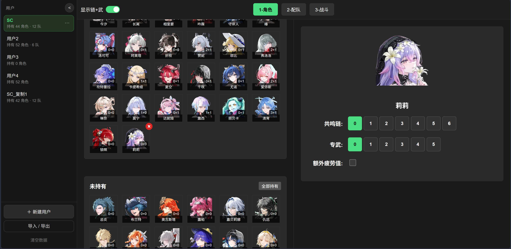
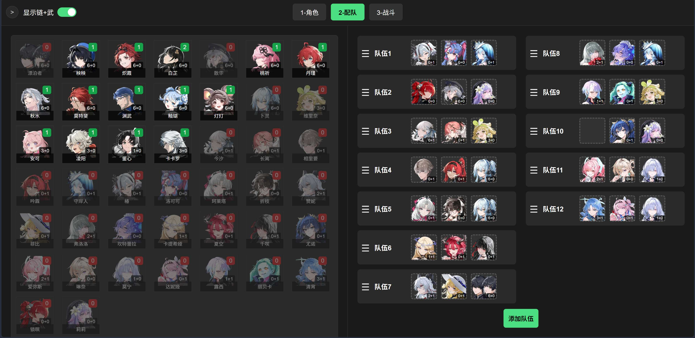
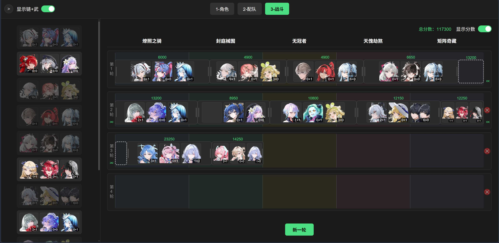

# 鸣潮矩阵编队模拟

一个用来规划《鸣潮》多轮 BOSS 玩法编队的纯静态网页工具：先录入自己的角色库，再排出若干支三人队，最后把队伍摆到各轮 BOSS 血条上，估算每队打掉多少血量、能拿多少分。

- **在线使用**：https://wuwamatrix.pages.dev/
- **源码仓库**：https://github.com/scnf-8848/WuWa-Matrix-Scheduling
- 纯 HTML + CSS + 原生 JavaScript，无构建步骤、无第三方依赖、无后端、不联网、不需要登录。
- 所有数据只保存在当前浏览器的 `localStorage`，换浏览器、换设备或清理站点数据都不会自动同步，请用导出功能自行备份。
- 以桌面端鼠标操作为主要设计目标，窄屏做了基本适配。
- 代码部分以 [MIT License](./LICENSE) 授权；**第三方图片素材不在授权范围内**，见 [NOTICE.md](./NOTICE.md)。

> ⚠️ 界面里的角色头像并非本项目原创，来自第三方游戏解包资源仓库；本项目作者**不拥有这些图片的版权**，也未取得权利方授权，**这些图片不在 MIT 授权范围内**。详见文末 [素材来源与版权声明](#素材来源与版权声明) 与 [NOTICE.md](./NOTICE.md)。

---

## 功能

### 1-角色：维护角色库



- 按「已持有 / 未持有」分区显示角色，点一下即可切换持有状态；「全部持有」「全部没有」可批量操作。
- 选中角色后，在右侧设置**共鸣链（0–6）**、**专武精炼（0–5）**与**额外疲劳值**。
- 每个角色有基础可用次数；勾选「额外疲劳值」后可用次数 +1，用于表达该角色可以多上场一次。
- 页面底部实时显示当前用户的**分享码**，可直接复制；也可从分享码或带码链接导入。

### 2-配队：排出三人队



- 左侧角色池只列出已持有的角色，并显示剩余可用次数；把角色拖进右侧队伍的槽位即可编队。
- 支持槽位之间搬运 / 互换、拖回角色池移除、整支队伍拖动排序。
- 同一支队伍里不能出现重复角色，角色被放进队伍的总次数不能超过其可用次数；取消持有会自动从槽位里清掉该角色。

### 3-战斗：把队伍分配到多轮 BOSS



- 每轮是一条由 5 个 BOSS 等分的轨道。把左侧的队伍拖到轨道上，**块的宽度就代表该队打掉的血量占比**；可以拖动位置、拉伸左右边缘，块允许横跨 BOSS 列边界。
- 队伍可以跨轮连续作战（打完上一轮紧接着打下一轮），界面用 `∝` 链接与「自动续接占位」表达跨轮的连续输出，连窄到画不出队伍块的间隙也能算进去；自动占位可点击切换是否计入分数。
- 分数按「块覆盖各 BOSS 列的比例 × 该列基础分」累加，显示值取整到 50 分；每轮第 5 列「矩阵奇藏」另有 1000 分击杀奖励，整笔归收尾队，不随血条平摊。悬停队伍块可看逐 BOSS 的得分明细。
- 可增删轮次、开关分数显示；BOSS 名称与各轮基础分写在代码里，游戏版本更新时手动维护。分数是**按录入数值做的估算，仅供方案之间比较**，不代表游戏内实际结算结果。

### 左侧用户栏：一人一份数据

左侧栏管理多个「用户」，每个用户各自拥有一整套角色库、队伍、额外疲劳和页面 3 排布 —— 帮别人配队时，一个用户就是一份作业。支持新建、重命名、复制、删除、拖动排序；行内 `⋯` 菜单的「导出」同时给出分享码和单人 json 文件。侧栏底部的「导入 / 导出」则是**全部用户**的 json 备份入口。

---

## 分享码与备份文件：两条独立的通道

| | 分享码 | json 备份文件 |
| --- | --- | --- |
| 范围 | 单个用户的**角色库** | 全部用户（用户行 `⋯` 里也可导出单个用户） |
| 包含 | 持有、共鸣链、专武**有无**、额外疲劳 | 角色库（含专武精炼）、队伍、额外疲劳、页面 3 排布 |
| 不包含 | 专武精炼、**编队方案**、页面 3 排布 | — |
| 形式 | 十几位字符，或 `站点根#码` 形式的链接 | 一个 `.json` 文件 |
| 用途 | 发给别人同步「我有哪些角色」，对方按这个库配好队再截图回传 | 换机器 / 换浏览器 / 归档与完整还原 |

**分享码不带配队**，因为本项目没有服务器，配队结果只能靠截图传递。打开带码链接时，站点会校验分享码、自动新建或切换到同状态的用户，然后清掉地址栏里的 hash。

json 文件导入分**合并**（追加到现有用户后面，重名自动加序号）和**覆盖**（先清空全部用户，需二次确认，不可撤销）；单人文件只允许追加，不会被用来覆盖整个用户列表。导入时会重新分配用户 id，避免与本机已有用户撞号。

---

## 本地运行与开发

直接用浏览器打开 `index.html` 就能用（`file://` 亦可）。想用本地服务器：

```bash
python -m http.server 8000
# 然后访问 http://localhost:8000
```

部署时把仓库根目录作为静态站点发布目录即可（在线版托管在 Cloudflare Pages），无需构建或安装依赖。

### 文件结构

| 路径 | 作用 |
| --- | --- |
| `index.html` | 页面骨架与所有弹窗；按依赖顺序引入经典脚本 |
| `styles.css` | 全部样式，布局常量集中在 `:root` 的 `--bp-*` / `--us-*` 变量 |
| `characters.js` | 角色模板表：`id` / `name` / `totalUses`（基础可用次数） |
| `js/core.js` | 头像路径与扩展名回退、写盘、轻提示、站点根、keyed 渲染 |
| `js/sharecode.js` | 分享码编解码（纯函数，不碰 DOM 与存储） |
| `js/store.js` | 运行态、`localStorage` 读写、用户管理、备份文件的构建与解析 |
| `js/boss-model.js` | 页面 3 的数据模型：排布、续接、计分（纯函数） |
| `js/layout.js` / `js/drag.js` | 布局计算与通用拖拽骨架 |
| `js/page-role.js` / `js/page-team.js` / `js/page-boss.js` | 三个页面各自的渲染与交互 |
| `js/app.js` | 用户栏、导航、导入导出与初始化 |
| `character/` | 按角色名命名的头像文件（`名.webp`，另支持 png / jpg / jpeg / gif 回退） |
| `docs/images/` | 本 README 使用的界面截图 |
| `LICENSE` | 代码部分的 MIT 许可证全文（不覆盖第三方图片素材） |
| `NOTICE.md` | 第三方素材清单与权利状态说明 |

不用 ES module、不做打包，是为了让 `file://` 直接打开也能跑，并且页面里的内联事件能直接调用全局函数。

### 新增 / 维护内容

- **加角色**：在 `characters.js` 追加 `{ id, name, totalUses }`，`id` 取当前最大值 +1；再把头像按角色名放进 `character/`。书写顺序只决定页面展示顺序，可以自由调整分组。
- ⚠️ **`id` 是分享码的编码顺序键**：分享码按 `id` 升序逐位记录角色状态。老 `id` 不改、不复用、不删除、不在中间插空号，否则旧分享码会整段错位。
- **BOSS 名称与各轮基础分**：在 `js/boss-model.js` 的 `BOSS_DEF_NAMES` 与 `BOSS_ROUND_SCORES`，游戏版本更新时手动维护。
- 数据键为 `gameUsersMeta` 与 `userData_<uid>`；备份文件带 `app` / `format` 标识，导入前会做校验和清洗。

---

## 素材来源与版权声明

- **代码部分**（`index.html`、`styles.css`、`characters.js`、`js/`）以 [MIT License](./LICENSE) 授权；**下列第三方图片素材不在该授权范围内**，完整清单与权利说明见 [NOTICE.md](./NOTICE.md)。
- `character/` 目录下的**角色头像等游戏美术素材不是本项目原创**，取自 [TomyJan/WutheringWaves-UIResources](https://github.com/TomyJan/WutheringWaves-UIResources) —— 该仓库自述为「鸣潮游戏解包 UI 资源 | Unpacked UI resources of Wuthering Waves」。本项目仅按角色名整理、重命名这些图片以便在界面中按名加载，未对图片本身主张任何权利。
- 这些素材来自《鸣潮》游戏客户端，其著作权及相关权益**应归游戏权利人（库洛游戏 / Kuro Games 等）所有**。本项目作者**不拥有图片版权，也未取得权利方授权**；上游仓库目前同样未声明开源许可证（GitHub 显示 `license: null`，仓库内也没有 LICENSE 文件），因此「可以公开下载」并不等于「图片已被自由授权」。
- 因此，**头像图片不随本项目源码一同授权**：MIT 只覆盖代码，不覆盖上述素材，也不授予任何复制、修改、分发或再使用的权利。若需 fork、二次分发或商用，请先自行确认素材的权利状态，或删除 `character/` 与 `docs/images/`、替换为自有或已获授权的素材；`docs/images/` 里的界面截图同样含有这些游戏素材，一并排除。
- 本项目是**非官方、非商业的粉丝自制编队辅助工具**，与游戏开发商、发行商没有任何隶属、关联或背书关系，图片仅用于在界面里辨认角色。
- 如权利方或上游维护者认为此处使用不妥，请在本仓库提 issue 联系，我会尽快移除或替换相关素材。

---

## 其他说明

- 页面 3 的分数表是按游戏内数值录入的近似值（部分轮次取平均、结果取整到 50 分），只用于比较不同排布方案，不作为游戏内结算依据。
- 本站不收集、不上传任何数据；浏览器存储被禁用或写满时，改动只在当前页面有效，刷新后会丢失，界面会给出提示。
- 上述许可与版权说明为事实陈述，不构成法律意见。
